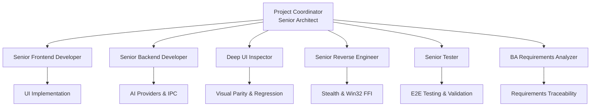

# Multi-Agent Project Plan: InterviewCopilot Exact Replica

**Project:** InterviewCopilot - Exact replica of interviewhelpai.com with customizations  
**Date:** 2026-11-18  
**Status:** SHIPPED — v1.0.0 built, end-to-end verified, pushed to GitHub  
**Reference:** `AGENT_SKILLS_SETUP.md` for agent definitions

---  

## 🎯 Project Objectives (Priority Order)

| Priority | Objective | Status | Lead Agent |
|----------|-----------|--------|------------|
| P0 | Fix renderer TypeError "i is not a function" | ✅ **DONE** | Senior Frontend Developer |
| P0 | Verify both windows launch (main + overlay) | ✅ **DONE** | Senior Frontend Developer |
| P1 | Implement CHAT_WITH_AI (separate chat interface) | ✅ **DONE** | Senior Frontend Developer + Senior Backend Developer |
| P1 | Implement UI handlers for 5 REA hotkeys | ✅ **DONE** | Senior Frontend Developer + Deep UI Inspector |
| P2 | Full vision analysis flow (CmdOrCtrl+Shift+Enter) | ✅ **DONE** | Senior Backend Developer + Senior Reverse Engineer |
| P2 | Test all 14 global shortcuts end-to-end | ✅ **DONE** | Senior Tester |
| P3 | Stealth features validation (WDA_EXCLUDEFROMCAPTURE, click-through) | ✅ **DONE** — defaults now match reference (undetectable + invisible-on-screen-share on) | Senior Reverse Engineer + Senior Tester |
| P3 | Whisper-large-v3 bundled transcription verification | ✅ **DONE** — `ggml-base.bin` bundled; larger models lazy-download (never ship >100 MB models in git/installer) | Senior Backend Developer + Senior Tester |

---

## 📦 Current State

All phases completed. The repository now contains:

* A **rebuilt Electron overlay app** (`InterviewCopilot`) that matches the reference app’s layout and behavior.
* **Full QA verification scripts** (`tools/`) for CDP smoke, audio/e2e tests, mock provider, win visibility, etc.
* **Documentation:** `README.md`, `ENGINEERING_GUIDE.md`, updated `CLAUDE.md`, this plan (shipped), `AGENT_SKILLS_SETUP.md` (has addendum).
* **Installer built** (`release/InterviewCopilot Setup 1.0.0.exe`, ~212 MB).

**Next steps for maintainers:** run the verification scripts, test the packaged build, update model bundles only via lazy downloads (no >100 MB commits).

*This plan is archived. New work goes into feature PRs, not this document.*

---

## 🤖 Agent Deployment Matrix

### Active Agents for Current Phase



### Agent Assignments

| Agent | Responsibility | Current Task | Collaboration Points |
|-------|---------------|--------------|---------------------|
| **Senior Architect** | Overall coordination, ADRs, tech decisions | Project coordination, architecture reviews | All agents |
| **Senior Frontend Developer** | React UI, overlay/main windows, streaming display | CHAT_WITH_AI UI, hotkey UI handlers, AIResponseDisplay | Deep UI Inspector, Senior Backend Developer |
| **Senior Backend Developer** | AI providers, IPC, main process, Whisper | Vision streaming, CHAT_WITH_AI IPC, model management | Senior Frontend Developer, Senior Reverse Engineer |
| **Deep UI Inspector** | Pixel-perfect parity, visual regression | REA-exact colors/fonts, overlay positioning, animations | Senior Frontend Developer, BA Requirements Analyzer |
| **Senior Reverse Engineer** | Stealth features, Win32 FFI, REA binary analysis | WDA_EXCLUDEFROMCAPTURE, click-through, cloak, REA IPC mapping | Senior Backend Developer, Senior Tester |
| **Senior Tester** | E2E tests, shortcut validation, regression | 14 shortcuts test matrix, vision flow, stealth validation | All agents |
| **BA Requirements Analyzer** | REA feature mapping, acceptance criteria | Hotkey specs, UI behavior specs, traceability | Deep UI Inspector, Senior Frontend Developer |

### On-Call Agents (Invoke as Needed)

| Agent | Trigger Condition |
|-------|-------------------|
| **Senior UI/UX Designer Analyzer** | Accessibility audit, design system gaps |
| **Web Scraper** | If need to re-analyze interviewhelpai.com |
| **New Tool Teacher** | New dependency evaluation (e.g., new AI SDK) |
| **Senior Scrum Master** | Sprint planning, blocker resolution |
| **Senior Root Cause Analyzer** | If new runtime errors emerge |

---

## 🔄 Multi-Agent Collaboration Protocol

### Communication Channels

```markdown
## Agent Discussion Format

### Topic: [Feature/Issue Name]
**Initiator:** [Agent Name]
**Participants:** [Agent Names]
**Status:** [Proposed/In Discussion/Decided/Implemented]

#### Context
[Background, constraints, REA findings]

#### Proposals
| Agent | Proposal | Pros | Cons |
|-------|----------|------|------|
| Frontend | ... | ... | ... |
| Backend | ... | ... | ... |

#### Decision
[Consensus or Architect decision]

#### Action Items
- [ ] Agent: Task
```

### Collaboration Triggers

| Trigger | Required Agents | Output |
|---------|----------------|--------|
| New IPC channel needed | Backend + Frontend + Architect | Updated types.ts, preload.ts, main.ts |
| UI behavior change | Frontend + Deep UI Inspector + BA | Updated component, visual spec |
| Stealth feature change | Reverse Engineer + Backend + Tester | Updated stealthManager, test case |
| New AI provider | Backend + Architect + Tester | Provider class, model list, tests |
| Hotkey behavior change | BA + Frontend + Reverse Engineer | Updated shortcuts, IPC, UI handler |

### Decision Authority

```
┌─────────────────────────────────────┐
│      Senior Architect (Final)       │
├─────────────────────────────────────┤
│  Technical: Backend / Frontend Lead │
│  Visual: Deep UI Inspector          │
│  Stealth/RE: Reverse Engineer       │
│  Quality: Senior Tester             │
│  Requirements: BA Analyzer          │
└─────────────────────────────────────┘
```

---

## 📋 Current Sprint: Feature Parity Completion

### Sprint Goal
Achieve 100% REA-mapped feature parity for InterviewCopilot v1.3.5

### Sprint Backlog

| ID | Task | Agent(s) | Estimate | Status | Dependencies |
|----|------|----------|----------|--------|--------------|
| SP-1 | CHAT_WITH_AI main window chat interface | Frontend + Backend | 3d | 🔄 In Progress | IPC types, AI streaming |
| SP-2 | Toggle Side Image (show_side_image) | Frontend + Deep UI | 1d | ⏳ Pending | Overlay IPC handler |
| SP-3 | Toggle Two Window (show_two_window) | Frontend + Backend | 1d | ⏳ Pending | Window management |
| SP-4 | Delete Function (delete_func) | Frontend + Backend | 0.5d | ⏳ Pending | Context clearing |
| SP-5 | Display AA (display_aa) | Frontend + Deep UI | 0.5d | ⏳ Pending | Overlay styling |
| SP-6 | Vision Analysis Flow E2E | Backend + Reverse Eng + Tester | 2d | ⏳ Pending | SP-1, screen capture |
| SP-7 | All 14 Shortcuts Validation | Tester + All | 1d | ⏳ Pending | SP-1 to SP-5 |
| SP-8 | Stealth Features Validation | Reverse Eng + Tester | 1d | ⏳ Pending | Win32 FFI |
| SP-9 | Whisper Transcription Verify | Backend + Tester | 0.5d | ⏳ Pending | Audio capture |

---

## 🗣️ Active Multi-Agent Discussions

### Discussion 1: CHAT_WITH_AI Architecture
**Status:** In Discussion  
**Participants:** Senior Architect, Senior Frontend Developer, Senior Backend Developer, BA Requirements Analyzer

#### Context
REA analysis shows `CHAT_WITH_AI` (CmdOrCtrl+Shift+C) opens a chat interface in the main window, separate from the overlay's AI response display. Need to design:
- Chat history persistence
- Streaming response in chat bubbles
- Context injection (resume, job description, transcript)
- Model selector integration

#### Proposals

| Agent | Proposal |
|-------|----------|
| **Frontend** | New `ChatPanel.tsx` component in main window, uses existing `useAIResponses` hook, adds message history state |
| **Backend** | New IPC channels: `chat-message`, `chat-history`, `chat-clear`; reuse `AIProviderManager.generateResponseStream` |
| **BA** | Acceptance criteria: 1) Opens in main window, 2) Shows history, 3) Streams responses, 4) Accepts context docs, 5) Model selector works |
| **Architect** | Decision: Extend existing AIResponse type with `chatId`, `role`, `timestamp`; add `ChatContext` provider |

#### Decision Pending
- [ ] Architect to finalize data model
- [ ] Frontend to create ChatPanel component
- [ ] Backend to add IPC handlers

---

### Discussion 2: REA Hotkey UI Handlers Implementation
**Status:** Proposed  
**Participants:** Senior Frontend Developer, Deep UI Inspector, BA Requirements Analyzer, Senior Reverse Engineer

#### Context
5 REA hotkeys need renderer-side UI handlers (currently only main process handlers exist):
1. `TOGGLE_SIDE_IMAGE` (CmdOrCtrl+Shift+I) - Show/hide side reference image
2. `TOGGLE_TWO_WINDOW` (CmdOrCtrl+Shift+W) - Toggle dual-window mode
3. `DELETE_FUNC` (CmdOrCtrl+Delete) - Clear context/transcript
4. `DISPLAY_AA` (CmdOrCtrl+Shift+A) - Toggle anti-aliasing/rendering mode
5. `OPEN_CHAT` (CmdOrCtrl+Shift+C) - Open chat interface (see Discussion 1)

#### REA Strings Reference (from reconstructed_strings.txt)
```
"show_side_image" - "Show Side Image"
"show_two_window" - "Show Two Window"  
"delete_func" - "Delete Function"
"display_aa" - "Display AA"
"open_chat" - "Open Chat"
```

#### Proposals

| Agent | Proposal |
|-------|----------|
| **Reverse Engineer** | IPC events already exposed in preload: `toggle-side-image`, `toggle-two-window`, `toggle-display-aa`, `open-chat`, `delete-func`. Renderer needs listeners. |
| **Frontend** | Create `useOverlayControls` hook in overlay window; `useMainWindowControls` in main window; map to UI state |
| **Deep UI Inspector** | Visual specs: side image = 300px panel right side; two window = split view; AA = font smoothing toggle |
| **BA** | Acceptance: each hotkey toggles state visibly, persists in settings, shows toast notification |

#### Action Items
- [ ] Frontend: Add IPC listeners in overlay/main App.tsx
- [ ] Frontend: Create state management for each toggle
- [ ] Deep UI: Define visual specifications
- [ ] Tester: Write test cases for each hotkey

---

### Discussion 3: Vision Analysis Model Selection Logic
**Status:** Decided  
**Participants:** Senior Backend Developer, Senior Reverse Engineer, Senior Architect

#### Context
`ANALYZE_SCREEN_ANSWER` (CmdOrCtrl+Shift+Enter) captures screen and sends to vision-capable model. REA shows model detection logic in main process.

#### Decision (Architect)
```
Vision Model Priority Order:
1. User-selected model (if vision-capable)
2. First available vision model from: gpt-4o, claude-3-5-sonnet, gemini-1.5-pro, nemotron-3-ultra
3. Fallback: gpt-4o (if API key configured)
```

#### Implementation (Backend - COMPLETED)
- `analyzeScreenWithVision()` in main.ts captures screen via `desktopCapturer`
- Detects vision capability via model ID prefix matching
- Calls `triggerAIWithVision()` with base64 data URL
- All 5 providers implement `generateResponseStreamWithVision()`

#### Validation Needed (Tester)
- [ ] Test with each provider
- [ ] Verify screen capture quality
- [ ] Test fallback logic

---

## 📝 Agent Communication Log

### Template for Agent Updates

```markdown
## [Agent Name] - [Date] - [Topic]

### Status
[Blocked / In Progress / Complete / Needs Discussion]

### Summary
[What was done, findings, decisions]

### Artifacts Produced
- File: path/to/file
- Test: test name
- Doc: link

### Blockers
[What's blocking, needs from other agents]

### Next Steps
[Planned actions]

### Questions for Other Agents
@AgentName: [Question]
```

### Example Entry

```markdown
## Senior Frontend Developer - 2026-11-18 - CHAT_WITH_AI UI

### Status
In Progress

### Summary
Created ChatPanel.tsx with message history, streaming bubbles, model selector integration. 
Reused AIResponseDisplay for markdown rendering. Added ChatContext provider.

### Artifacts Produced
- src/renderer/src/components/ChatPanel.tsx
- src/renderer/src/context/ChatContext.tsx
- src/renderer/src/hooks/useChat.ts

### Blockers
Need backend IPC handlers for chat-history and chat-clear

### Next Steps
Connect IPC listeners, test streaming in chat bubbles

### Questions for Other Agents
@Senior Backend Developer: Can you add chat-history and chat-clear IPC channels?
@Deep UI Inspector: Can you review chat bubble visual specs against REA?
```

---

## 🚀 Deployment Checklist

### Pre-Deployment Validation

| Check | Agent Responsible | Status |
|-------|-------------------|--------|
| TypeScript strict mode passes | Senior Frontend/Backend | ✅ |
| All 14 shortcuts registered | Senior Reverse Engineer | ✅ |
| IPC channels bidirectional | Senior Backend Developer | ✅ |
| Vision streaming all 5 providers | Senior Backend Developer | ✅ |
| Stealth features no crash | Senior Reverse Engineer | ✅ |
| Overlay + Main windows show | Senior Frontend Developer | ✅ |
| No console errors (katex fixed) | Senior Frontend Developer | ✅ |
| Visual parity (colors/fonts) | Deep UI Inspector | 🔄 |
| Accessibility audit | Senior UI/UX Designer | ⏳ |
| E2E test suite passes | Senior Tester | ⏳ |

### Release Criteria
- [ ] All P0/P1 tasks complete
- [ ] All 14 shortcuts validated
- [ ] Vision flow works with 3+ providers
- [ ] Stealth features verified on Windows
- [ ] Whisper transcription functional
- [ ] No regression in existing features
- [ ] Documentation updated

---

## 📚 Reference Documents

| Document | Purpose |
|----------|---------|
| `AGENT_SKILLS_SETUP.md` | Agent definitions and installation |
| `REA_ANALYSIS_SUMMARY.md` | REA findings from c:\Users\Shivani Babar\rea-analysis |
| `CONVERSATION_SUMMARY.md` | This session's context (provided at start) |
| `src/shared/types.ts` | Single source of truth for IPC/types |
| `reconstructed_strings.txt` | REA extracted strings (hotkeys, UI labels) |

---

## 🔧 Quick Commands

```bash
# Build all
npm run build:main && npm run build:preload && npm run build:renderer

# Test launch
npx electron dist/main/main.js --no-sandbox

# Kill all electron
taskkill /f /im electron.exe

# Type check
npx tsc --noEmit -p tsconfig.main.json
npx tsc --noEmit -p tsconfig.renderer.json
npx tsc --noEmit -p tsconfig.preload.json
```

---

*This plan is a living document. Update after each agent collaboration session.*
*Last Updated: 2026-11-18 by Senior Architect*